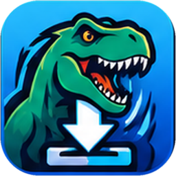

# Rextract

### Your media. Your transcripts. One place.

**A Windows media downloader and local AI transcription desktop app.**  
By **speakerfreak & darkmatter**

[**Download Rextract for Windows**](https://github.com/DarkMatter0352/Rextract/releases/latest) · [Latest release](https://github.com/DarkMatter0352/Rextract/releases/latest) · [Licenses & credits](LICENSING.md)

---

## Meet Rextract

Rextract brings **downloads**, **transcription** and a **media library** together in one dark-themed desktop application. It integrates the native [Vibe](https://github.com/thewh1teagle/vibe) transcription experience, so you don't need to install a separate copy of Vibe.

| Download | Transcribe | Library | Settings |
| --- | --- | --- | --- |
| Paste one link or several and download supported media. | Transcribe audio or video locally with Vibe's engine. | Find and open your downloaded files. | Check for signed Rextract updates, read licenses, or uninstall. |

### Features

- **Save media** from supported YouTube, Instagram, X/Twitter and Bluesky links. Site support can change when the services change.
- **Optional Chrome Companion:** blue **MP4** and green **MP3** buttons on YouTube videos and Shorts, plus discreet buttons on Instagram, X and Bluesky. See real download progress without leaving Chrome.
- **Quiet background downloads:** keep Chrome in front while Rextract works from the Windows tray; choose whether the app window opens or stays hidden.
- **Choose your format:** videos, audio-only downloads, photo formats and quality options as applicable.
- **Download progress you can see:** status, progress indicator, Stop, and a live activity log.
- **Built-in transcription:** use Vibe's native transcription workflow, history, playback, and export features.
- **One media folder:** downloads are saved under your **Documents / Rextract** folder by default.
- **Signed in-app updates:** check and install newer published Rextract releases from **Settings → Rextract Updates**.
- **Uninstall choices:** remove only the app, or request a full cleanup of Rextract/Vibe-related data. **Full uninstall is destructive.**

> **Early-access Windows build:** Rextract is being actively developed. Test with nonessential files first, keep backups of important transcripts, and report unexpected behavior to the project maintainers.

## Download and install

**[⬇ Download the latest official Rextract release](https://github.com/DarkMatter0352/Rextract/releases/latest)**

1. Open the link above. You do **not** need a GitHub account.
2. Expand **Assets** if necessary.
3. Download the Windows installer named **`Rextract_*_x64-setup.exe`**. This is the app installer, not the `.sig` or `latest.json` files.
4. Run the installer, then open **Rextract** from Windows.

### Chrome Companion (v0.2.16 and newer)

**Current public versions:** Rextract desktop **v0.2.17** and Chrome Companion **v0.2.7**. YouTube watch pages and Shorts have separate **MP4 video** (blue) and **MP3 audio** (green) buttons. On Shorts, the controls are positioned in the right-side action area, outside the video, rather than covering the video. Bluesky feed/repost/thread improvements remain included. If you already have Rextract desktop v0.2.17, **you only need to replace the Chrome extension** to get this placement fix.

The optional Chrome Companion adds one-click download arrows to supported **YouTube, Instagram, X/Twitter and Bluesky** posts. It communicates only with the Rextract helper installed on your own Windows computer.

1. On the **same release page** as the Windows installer, download **`Rextract-Chrome-Companion.zip`**.
2. Extract the ZIP into a **permanent folder** (don't load the ZIP itself).
3. In Chrome, open `chrome://extensions`, turn on **Developer mode**, click **Load unpacked**, and select the extracted folder containing `manifest.json`.
4. Open Rextract → **Settings → Chrome Companion → Repair Chrome connection**; reload the extension if asked.
5. Refresh YouTube. On regular videos and Shorts, choose **MP4** (blue, video with sound) or **MP3** (green, audio-only). On Shorts, the buttons appear beside the right-side controls, above Like when the layout supports it. Instagram, X and Bluesky have the normal Rextract download arrow. The ring reflects download activity. If a site's layout changes and a button is missing, use the extension popup or paste the URL into Rextract.

**Updating Chrome Companion:** To replace an older version, remove the existing Rextract extension at `chrome://extensions`, extract the latest public ZIP into a permanent folder, click **Load unpacked**, and select that folder. **Chrome Companion updates aren't installed automatically by the Windows desktop updater.** Return to Rextract → **Settings → Chrome Companion → Repair Chrome connection** if Chrome reports a connection error. Refresh any open YouTube, Instagram, X, or Bluesky tabs.

This Chrome Companion is **not listed on the Chrome Web Store**. You install it using Chrome's Load unpacked option. It can stop working if social sites change their page layouts; if an arrow is missing, the extension popup's **Download current post** can be used on a supported media permalink.

### Background operation and full quit (v0.2.16+)

Chrome downloads can run quietly using Rextract's background tray process. You can **Quit Rextract completely** from Settings or its Windows tray menu to free resources. In Settings, **Quit when closing its window (X)** changes X from hide-to-tray to a full exit. The next Chrome download may start Rextract again as needed. Quitting while downloading interrupts active work.

**System:** Windows x64. An internet connection is needed for downloads and for obtaining any transcription models that aren't already on your computer. Rextract includes the native Vibe application experience; a separate standalone Vibe installation is **not required**.

**A note about Windows SmartScreen:** Rextract's in-app updater uses a cryptographic signature, but the downloadable installer does **not yet** have a Windows-trusted publisher/code-signing certificate. Windows may show an **Unknown publisher** warning. Only run installers you obtained from this official repository and personally trust; never disable SmartScreen globally.

## How to use it

### Download a video, photo or audio file

1. Open the **Download** tab and copy a supported YouTube, Instagram, X/Twitter or Bluesky URL.
2. Paste it into **PASTE LINKS** (or click **Paste from clipboard**). For multiple downloads, put **one link on each line**.
3. Under **DOWNLOAD OPTIONS**, leave **Smart (recommended)** and **Best available** selected to start, or choose the format and quality you want.
4. Click **DOWNLOAD**. Watch the progress bar and **LIVE ACTIVITY** for download and processing messages.
5. Click **Open folder** when finished. Files go to your Windows **Documents / Rextract** folder.

**What do the download options mean?**

| Option | What it does |
| --- | --- |
| **Smart (recommended)** | Automatically chooses an appropriate video/photo download method for the link. |
| **Videos only** | Downloads video when supported. |
| **Photos / carousels** | Downloads supported images and multi-image posts. |
| **MP3 (audio only)** | Extracts audio as an MP3 when supported. |
| **Video quality** | Choose best available or cap resolution at 4K, 1440p, 1080p, 720p or 480p. Availability depends on the source. |
| **YouTube playlists** | Turn this on if you deliberately want an entire playlist rather than one video. Leave it off otherwise. |
| **Instagram photo format** | Keep the original image, or choose JPG/PNG conversion where tools permit. |
| **Login cookies (optional)** | Use existing configuration, a supported local browser session, or a cookies.txt file when a website requires authentication. |

**Other Download controls:** **Stop** interrupts the active desktop download; **Clear** empties the pasted link box without deleting saved files; **Check tools** checks yt-dlp, gallery-dl and FFmpeg; **Fix saved photos** helps convert selected WebP images to your chosen format.

Some downloads need a valid website login or an available media stream. If something fails, read **LIVE ACTIVITY**, try the original post URL, and see the troubleshooting tips below. Never share your session cookies, login credentials or other secrets.

### Download directly from Chrome (optional)

Once you've installed the [Chrome Companion](#chrome-companion-v0216-and-newer) and repaired its desktop connection, refresh a supported website. **On YouTube videos and Shorts, choose blue MP4 to download the video or green MP3 to extract audio only** (useful for sound effects). The controls remain outside the Shorts video. Each has its own progress indicator. On Instagram posts/Reels, X posts and Bluesky posts, use the small Rextract download arrow near the native action buttons.

- The circular indicator means your request is **queued or downloading**; when available, it reflects transfer progress. A checkmark means the download has completed.
- The desktop app can stay **hidden in the background** while the download finishes.
- You can also click the pinned **Rextract Chrome extension icon** to use **Download current post**, **Transcribe last download**, or **Open Rextract**. The first action works on a supported post/video URL.
- If a button is missing on a particular site layout, use the extension popup on that post's direct URL, or paste its URL into the desktop app.

**Chrome does not put these files into its normal Downloads list.** The Rextract desktop helper saves them under **Documents / Rextract**.

### Transcribe audio and video

1. In Rextract, open the **Transcribe** tab, which contains the integrated Vibe interface.
2. Add an existing audio/video file, or click **Transcribe last download** after downloading one. In the **Library** tab, supported media also has a **Transcribe** action.
3. Follow the transcription interface to select an available model and start transcription. On first use, you may need to download a model.
4. Review your transcript and use the available history, playback and export features.

You can launch **Transcribe last download** from the Chrome Companion popup as well. Transcription uses Vibe's local engine; model downloads and new media downloads still require an internet connection. Images are not transcribed.

### Browse your downloads in Library

Open **Library** to see files in your Rextract download folder. Click **Refresh** to rescan it. Use **Transcribe** beside a supported audio/video file, or choose **Open folder** from the Download tab to work directly in Windows File Explorer.

### Settings, updates and background behavior

| Setting or action | What to expect |
| --- | --- |
| **Settings → Rextract Updates → Check now** | Checks the official signed release feed. If available, use **Update and restart**. Normal updates are designed to preserve your data. |
| **Open the Rextract window when downloading from Chrome** | Off by default: Chrome downloads run quietly in the background. On: open the desktop window to watch activity. |
| **Quit Rextract completely when closing its window (X)** | Off by default: X hides the window to the system tray. On: X exits the program, stopping active downloads. |
| **Quit Rextract completely** | Fully exits Rextract instead of leaving its background process running. You can also use the Windows tray icon's **Quit Rextract** option. |
| **Repair Chrome connection** | Re-registers the installed Chrome helper if the extension cannot contact Rextract. Reload the extension afterward. |

**Update:** A published Rextract update also updates its integrated Vibe version when the project ships one; it does **not** separately install each upstream Vibe release.

### Troubleshooting quick fixes

- **Chrome says the desktop connection is unavailable:** open Rextract → **Settings → Chrome Companion → Repair Chrome connection**, then visit `chrome://extensions` and reload Rextract. If the helper is missing, reinstall the **Windows installer**, not just the extension ZIP.
- **No download arrow on Instagram/Reels or another supported site:** refresh the page, check the extension is enabled, and try **Download current post** from its popup. Site layouts can change.
- **MP3 button is unavailable, saves the wrong format or conversion fails:** install the matching Windows app **v0.2.17+** and Chrome Companion **v0.2.5+**. Open **Download → Check tools** and verify yt-dlp and FFmpeg. Refresh YouTube after updating the extension.
- **The button stays queued or a download fails:** check whether Rextract is running and inspect the desktop **LIVE ACTIVITY** log. Try a different supported URL and click **Check tools**. Site restrictions and missing media tools can prevent downloads.
- **An Instagram post needs login:** a saved Instagram session or your own authorized cookies may be required. Treat session tokens like passwords; never paste them into public issues.
- **Transcription model missing or slow:** use Vibe's model selection/download flow and ensure enough disk space for the model. Processing time depends on your PC and model.
- **You want Rextract fully closed:** choose **Quit Rextract completely** in Settings or from the tray. Chrome may start it again if you initiate another download.

For help, include the **Rextract version**, Windows version, site, and the exact error message when reporting a problem—**never** include passwords, cookies, private URLs or personal media.

## The app

Rextract uses a dark navy and blue interface with four tabs: **Download · Transcribe · Library · Settings**.

*Actual app screenshots will be added here once any personal file paths and private account details have been removed.*

## Frequently asked questions

<b>Do I have to install Vibe separately?</b>

No. Rextract integrates the native Vibe transcription experience. Models may need to be downloaded separately on first use.

<b>Do I need Python, Node.js, PowerShell or GitHub?</b>

No. Those are developer/build tools. Regular Windows users install the downloaded `.exe` and use the app.

<b>How do I get newer versions?</b>

Use **Settings → Rextract Updates → Check now**. The built-in updater verifies officially signed Rextract update packages. You can also visit the [Releases page](https://github.com/DarkMatter0352/Rextract/releases/latest) for manual downloads.

<b>Will upgrading delete my downloads or transcripts?</b>

Normal in-place updates are intended to keep app data and media. Back up anything important before testing a new release. Avoid **Full uninstall** unless you deliberately want data removed.

<b>Why does Windows say “Unknown publisher”?</b>

Windows code signing is a separate system from the secure in-app update signatures. Windows-trusted publisher signing has not yet been configured for Rextract, so SmartScreen may warn on installation.

## Licenses, source and credits

**Rextract** is by **speakerfreak & darkmatter**. The original Rextract branding and private project contributions are rights-reserved; the source repository is not made public by this installer distribution.

Rextract includes and credits **[Vibe](https://github.com/thewh1teagle/vibe)** by thewh1teagle, which remains available under the **MIT License**, including its permissions for commercial use, modification, and redistribution. Other included third-party components may use other licenses.

Read [Licensing & Credits](LICENSING.md) and [Vibe's MIT notice](VIBE-MIT.txt).

---

**Get Rextract:** [Latest Windows installer](https://github.com/DarkMatter0352/Rextract/releases/latest)  
**Updates:** Delivered through signed Rextract releases · **Source:** Kept private

*Rextract · speakerfreak & darkmatter · Vibe MIT*

